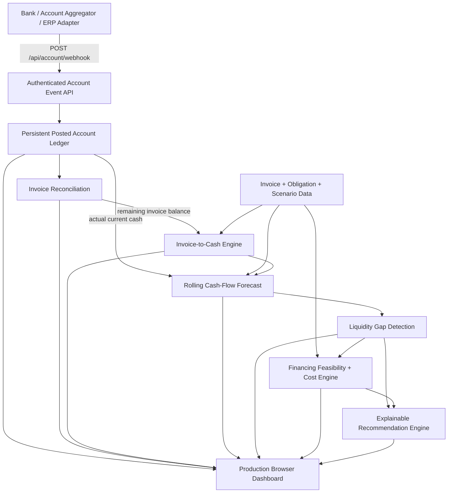

# Production architecture

## Runtime components

- `server/productionServer.js` serves the zero-dependency dashboard and same-origin API.
- `server/accountServer.js` persists and validates account events.
- `web/` contains the production dashboard.
- `src/lib/` contains the tested financial and reconciliation logic used directly by the browser as ES modules.
- `data/account_ledger.local.json` is runtime-only and excluded from Git.

## Account-credit flow

1. An authorised integration posts a unique account transaction.
2. The API rejects duplicate transaction IDs.
3. Posted credits increase actual available account cash. Posted debits reduce it.
4. If a credit contains `invoice_number`, it is applied to that invoice up to the remaining outstanding amount.
5. The invoice forecast sees only the remaining receivable.
6. The cash-flow forecast starts from tracked current cash.
7. Gap detection and financing recommendations therefore update after every account event.

## Security boundary

The generic event API can enforce `X-API-Key` on writes. A real provider adapter should also validate the provider's own webhook signature/authentication before translating the provider payload into the NovaNex event contract. Bank credentials must never be placed in frontend JavaScript.
