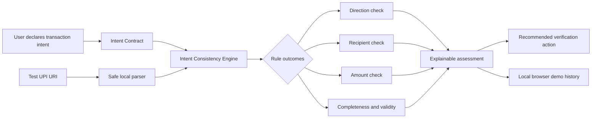

# PayGuard Architecture

PayGuard is intentionally client-only for the hackathon prototype. No banking integration, backend service, database, or external AI service is required.

## Module boundaries

- `src/utils/upiParser.js`: validates and parses supported `upi://pay` test URIs.
- `src/utils/intentEngine.js`: deterministic consistency rules and structured result generation.
- `src/data/scenarios.js`: built-in reproducible demonstration inputs.
- `src/components/`: reusable presentation components.
- `src/App.jsx`: application state, workflow, browser history, and UI orchestration.

## Data flow

1. The user states intended economic action.
2. The user selects a built-in scenario or pastes a simulated UPI URI.
3. The parser extracts `pa`, `pn`, `am`, `cu`, and `tn` where available.
4. The engine compares the parsed request with the user's intent.
5. The UI renders individual checks, the overall assessment, missing information, limitations, and the recommended next action.
6. A small non-sensitive assessment summary can be stored in `localStorage` for demo history.

## Security boundary

The app does not open the UPI URI, invoke a payment application, contact a bank, or request a UPI PIN or OTP. It only parses text supplied to the browser.
